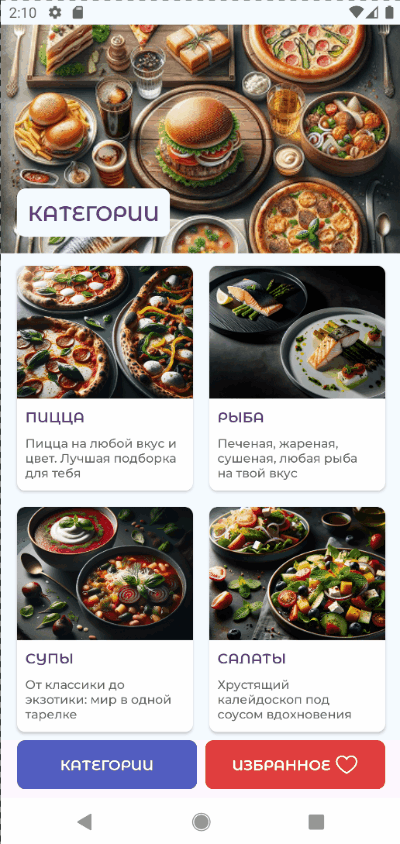
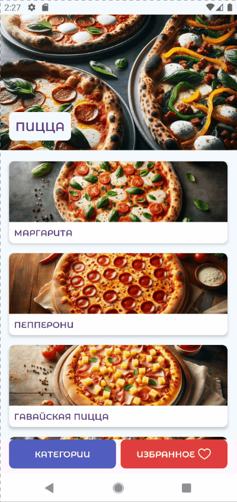

# RecipeApp

Android-приложение для просмотра рецептов, разработанное с использованием классического Android View System (XML) и компонентов Android Jetpack.

> Это XML-версия проекта. Аналогичное приложение, реализованное на Jetpack Compose, доступно в репозитории **[RecipeCompApp](https://github.com/vkozhanova/RecipeCompApp)**.

## Возможности
- Просмотр категорий рецептов
- Просмотр списка рецептов
- Просмотр подробной информации о рецепте
- Добавление и удаление избранных рецептов
- Локальное хранение данных
- Получение данных с удалённого API
## Demo
<table>
<tr>
<td align="center"><b>Categories</b></td>
<td align="center"><b>Details</b></td>
</tr>
<tr>
<td></td>
<td></td>
</tr>
</table>

## Технологии
- Kotlin
- Android View System (XML)
- ViewBinding
- Fragments
- Navigation Component + Safe Args
- RecyclerView
- MVVM
- Hilt
- Retrofit
- Kotlinx Serialization
- OkHttp
- Room
- Glide
- Coroutines + Flow
## Запуск проекта
1. Клонируйте репозиторий:
```bash
git clone https://github.com/vkozhanova/RecipeApp.git
```
2. Откройте проект в Android Studio.
3. Дождитесь синхронизации Gradle.
4. Запустите приложение на эмуляторе или физическом устройстве.
---
## Автор
**Vera Kozhanova**

GitHub: [@vkozhanova](https://github.com/vkozhanova)